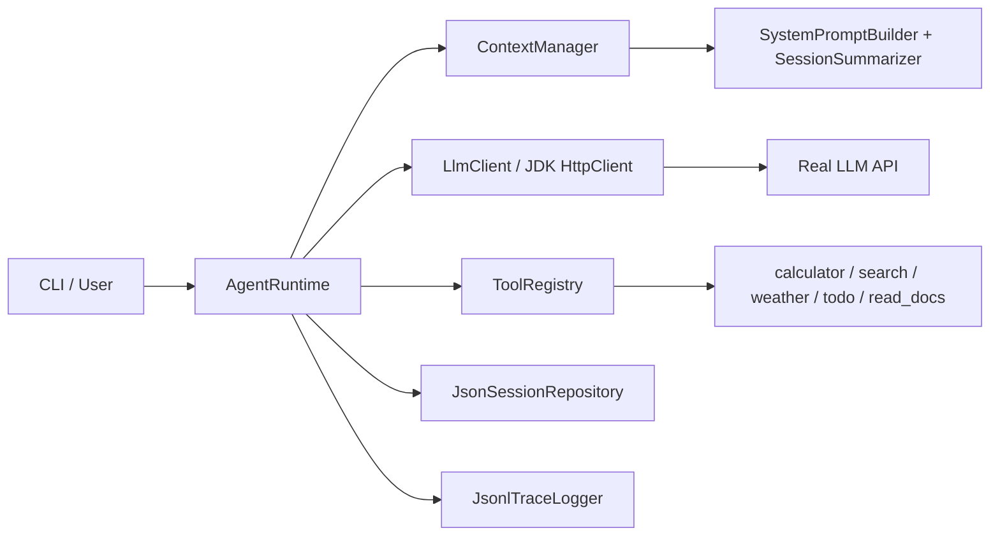

# MiniAgent Java

[](https://github.com/Jayhavena/mini-agent-java-delivery/actions/workflows/ci.yml)

Java 21 实现的最小可用 Agent，使用真实 LLM API，核心 Runtime 不依赖任何 Agent 框架。主流程、工具调度、输出解析、Session 与 Context 管理均在本仓库实现；运行时依赖只有 Jackson 和 JDK `HttpClient`。

- **先验收**：[本轮验证记录](<docs/verification.md>) · [真实模型双窗口演示](<docs/live-demo-output.md>) · [Trace 样例](<docs/sample-trace.jsonl>)
- **再看实现**：[AgentRuntime](<src/main/java/dev/nangua/miniagent/agent/AgentRuntime.java>) · [工具注册](<src/main/java/dev/nangua/miniagent/tool/ToolRegistry.java>) · [输出解析](<src/main/java/dev/nangua/miniagent/parse/AgentOutputParser.java>)
- **AI 协作记录**：[关键 Prompt、设计取舍与问题解决](<PROMPTS.md>)

> 模型请求真实发送到 DeepSeek / OpenAI-compatible API；`search`、`weather` 使用题目允许的 mock 数据源。默认测试不调用外部模型，真实 API 测试必须显式开启，可能产生费用。

## 1. 题目要求与验收入口

| 要求 | 实现 | 验证入口 |
|---|---|---|
| 自己实现 Agent Loop：直答或调用工具，基于结果继续 | [AgentRuntime](<src/main/java/dev/nangua/miniagent/agent/AgentRuntime.java>) | [Runtime 测试](<src/test/java/dev/nangua/miniagent/agent/AgentRuntimeTest.java>) |
| 至少 3 个工具，具备名称、描述、参数 Schema | [Tool](<src/main/java/dev/nangua/miniagent/tool/Tool.java>) / [ToolRegistry](<src/main/java/dev/nangua/miniagent/tool/ToolRegistry.java>)，共 5 个工具 | [工具测试](<src/test/java/dev/nangua/miniagent/tool/TodoAndRegistryTest.java>) |
| 模型自主选择工具，解析决策摘要 / 工具调用 / 最终回答 | [系统 Prompt](<src/main/java/dev/nangua/miniagent/context/SystemPromptBuilder.java>) / [Parser](<src/main/java/dev/nangua/miniagent/parse/AgentOutputParser.java>) | [解析测试](<src/test/java/dev/nangua/miniagent/parse/AgentOutputParserTest.java>) |
| 同一用户多个独立 Session，可重新加载继续对话 | [JsonSessionRepository](<src/main/java/dev/nangua/miniagent/session/JsonSessionRepository.java>) | [持久化测试](<src/test/java/dev/nangua/miniagent/session/JsonSessionRepositoryTest.java>) / [完整流程测试](<src/test/java/dev/nangua/miniagent/agent/AgentConversationFlowTest.java>) / 双窗口演示 |
| 纯对话追问、带工具追问与基础压缩 | [ContextManager](<src/main/java/dev/nangua/miniagent/context/ContextManager.java>) / [SessionSummarizer](<src/main/java/dev/nangua/miniagent/context/SessionSummarizer.java>) | [完整流程测试](<src/test/java/dev/nangua/miniagent/agent/AgentConversationFlowTest.java>) / [Context 测试](<src/test/java/dev/nangua/miniagent/context/ContextManagerTest.java>) |
| 最大轮次、异常处理和工具 Trace | [AgentConfig](<src/main/java/dev/nangua/miniagent/agent/AgentConfig.java>) / [JsonlTraceLogger](<src/main/java/dev/nangua/miniagent/trace/JsonlTraceLogger.java>) | Runtime 测试 / [Trace 测试](<src/test/java/dev/nangua/miniagent/trace/JsonlTraceLoggerTest.java>) |
| 真实 LLM、测试、README 与 AI Prompt 记录 | [Live test](<src/test/java/dev/nangua/miniagent/agent/DeepSeekLiveTest.java>) / [LiveDemo](<src/main/java/dev/nangua/miniagent/demo/LiveDemo.java>) | [验证记录](<docs/verification.md>) / [PROMPTS](<PROMPTS.md>) |

测试替身用于验证 Runtime 的机制，不代表模型在任意输入下都能正确决策；真实调用结果与自动化测试结果分别记录。

## 2. 快速开始

在仓库根目录执行。环境：JDK 21、Maven 3.9+。

### 2.1 先运行不调用真实模型的测试

```shell
mvn test
mvn -DskipTests package
java -jar target/mini-agent.jar --help
```

不需要 API Key，即使环境中已有 Key，默认测试也不会执行 `live` 标签测试。首次构建仍需下载 Maven 依赖；HTTP 客户端测试使用本地回环服务，不访问模型供应商。打包产物是 `target/mini-agent.jar`。

### 2.2 配置并运行真实模型

PowerShell：

```powershell
$env:LLM_API_KEY = "<your-api-key>"
$env:LLM_BASE_URL = "https://api.deepseek.com"  # 默认值，可省略
$env:LLM_MODEL = "deepseek-chat"              # 默认值，可省略
.\run.cmd -User alice
```

Bash：

```bash
export LLM_API_KEY="<your-api-key>"
export LLM_BASE_URL="https://api.deepseek.com"
export LLM_MODEL="deepseek-chat"
bash run.sh alice
```

也可以设置环境变量后直接执行 `java -jar target/mini-agent.jar --user alice`。

[配置模板](<.env.example>) 只列出环境变量，程序**不会自动加载 `.env` 文件**。`DEEPSEEK_API_KEY` 可作为 `LLM_API_KEY` 的回退；Windows [启动脚本](<run.ps1>) 还会尝试读取用户级的 `DEEPSEEK_API_KEY`，Maven / 直接 Java 运行则需确保当前进程有该变量。不要将真实 Key 写进仓库或演示文件。

### 2.3 显式真实 API 验证

配置好 Key 后执行，**会调用外部 API，可能计费**：

```shell
mvn -Plive test
java -cp target/mini-agent.jar dev.nangua.miniagent.demo.LiveDemo --data-dir data/live-demo --out data/live-demo-output.md
```

`live` profile 只运行真实 API 测试，未配置 Key 时明确失败，不把跳过误报为通过。演示输出默认写到本地 `data/`，审查后再选入公开证据；执行时先完成上面的打包。命令、版本与本次实测结果见[验证记录](<docs/verification.md>)。

## 3. 代表性演示：同一用户，两个窗口

两个终端分别运行：

```powershell
# 终端 A
.\run.cmd -User alice -New -Title "窗口1-天气待办"
# 终端 B
.\run.cmd -User alice -New -Title "窗口2-周报待办"
# 重启后加载指定窗口
.\run.cmd -User alice -Session s_xxxxxxxxxxxx
```

验收顺序：

1. A：查询杭州天气，并记待办“明天带伞”。
2. B：读取 [项目说明](<docs/agent-notes.md>)，根据项目笔记写周报，并记待办“周五 18:00 前发周报”。
3. A：追问“刚才的天气和待办是什么？”
4. B：列出本窗口待办，确认没有 A 的待办。
5. 关闭后按 Session ID 加载，再继续聊。

也可在一个进程内使用 `/new`、`/sessions`、`/use <id>` 切换。这里验证的是**不同 Session 的隔离**，不是同一 Session 的并发写入安全。

[真实演示输出](<docs/live-demo-output.md>) 展示交替对话、工具参数、结果和两个窗口的持久化 todo。[Trace 样例](<docs/sample-trace.jsonl>) 是精选 JSONL 事件，不是全部原始 HTTP 流量。两者的生成时间与来源以文件和验证记录为准，不将历史记录冒充本次测试。

## 4. 系统设计

### 4.1 结构与 Agent Loop



一个用户 turn 内的循环由 [AgentRuntime.chat](<src/main/java/dev/nangua/miniagent/agent/AgentRuntime.java>) 显式控制：

```text
接收并保存 USER
  → 必要时压缩旧历史
  → 重建 Context → 调用 LLM → 解析 JSON
      ├─ final：保存最终回答，返回
      ├─ tool_call：注册表分发 → 结果保存为 TOOL_RESULT → 下一 step
      └─ 协议错误：保存纠错提示 → 下一 step
  → 调用失败或达到次数上限：返回降级回答
```

默认单 turn 限制：`maxSteps=8`、`maxToolRounds=6`、`maxParseRetries=2`。解析失败累计计数，默认最多允许 2 次纠错重试，第 3 次失败停止；失败工具调用也计入工具次数。持久化或 Trace 写入故障不保证能降级成功，见限制说明。

### 4.2 工具注册与模型决策

每个工具实现 [Tool 接口](<src/main/java/dev/nangua/miniagent/tool/Tool.java>)：`name()`、`description()`、`parameterSchema()`、`execute(context, arguments)`。[AgentFactory](<src/main/java/dev/nangua/miniagent/agent/AgentFactory.java>) 显式注册，[ToolRegistry](<src/main/java/dev/nangua/miniagent/tool/ToolRegistry.java>) 拒绝重名并按名称调度。

| 工具 | 实际能力 | 主要参数 |
|---|---|---|
| `calculator` | 手写递归下降表达式求值，不使用脚本引擎 | `expression` |
| `search` | 本地 mock 索引 | `query`、`limit` |
| `weather` | mock 城市天气 | `city`、`unit` |
| `todo` | Session 私有的 add/list/complete/delete | `action`、`text`、`id` |
| `read_docs` | 读取受限目录的 Markdown 示例 | `path` |

Schema 通过系统 Prompt 提供给模型，由模型决定直答还是调用工具，不使用关键词 if-else 决策。当前没有通用 JSON Schema 校验器：协议层检查外壳，参数规则由各工具检查；不能把 Schema 提示等同于完整强校验。

[项目说明](<docs/agent-notes.md>) 和 [产品 FAQ](<docs/product-faq.md>) 是可公开的示例输入，供 `read_docs` 使用，不是真实公司内部资料。

### 4.3 输出协议与解析

模型每次返回一个 JSON：

```json
{"type":"tool_call","thought":"先查询杭州天气","tool":"weather","arguments":{"city":"杭州"}}
```

```json
{"type":"final","thought":"已有足够结果","answer":"杭州天气数据来自 mock 数据源。"}
```

[Parser](<src/main/java/dev/nangua/miniagent/parse/AgentOutputParser.java>) 支持代码围栏、前后说明、字符串形式的参数 JSON，检查类型及必需字段。坏 JSON / 缺字段触发纠错轮；未知工具及工具参数错误以失败结果回灌。

`thought` 是简短决策摘要，不是完整内部思维过程。Prompt 要求少于 300 字符，Parser 的防御性截断上限实际为 2000 字符。工具调用摘要保存在历史中；最终回答的摘要单独存储，用户看到的是 `answer`。

选择自定义 JSON 而非原生 function calling，是为了明确展示输出解析与调度过程；代价是依赖模型遵守文本协议，不能保证每次都正确。

## 5. Memory：什么时候召回，放在哪里

### 5.1 召回时机

| 时机 | 读取或更新什么 | 实现 |
|---|---|---|
| 启动 / `/use` / `--session` | 从 JSON 读取消息、摘要、游标和 `toolState` | `JsonSessionRepository.find` |
| 用户输入落盘后 | 检查旧历史是否需要摘要压缩 | `ContextManager.maybeCompact` |
| **每次 LLM 调用前** | 重新构建规则、工具 Schema、摘要及尚未压缩的历史 | `ContextManager.build` |
| 工具结果保存后 | 下一 step 立即包含工具调用及结果 | `AgentRuntime` 循环 |
| 纯对话 / 工具追问 | 从最近原文或旧摘要解析指代，需要详情时再调用工具 | Context + 模型决策 |
| 正常最终回答后 / `/compact` | 检查压缩或手动压缩并保存摘要 | Context + CLI |

### 5.2 Context 放置方式

```text
system：稳定规则 + 工具 Schema + SESSION_MEMORY + SESSION_STATE + 输出协议
    SESSION_MEMORY：早期消息的确定性摘要
    SESSION_STATE：当前 Session 的 todo 总数 / 未完成数
尚未压缩的消息：
    user：用户原文
    assistant：tool_call JSON（含简短 thought 和参数）
    user：[TOOL_RESULT name=... ok=...] 结果 [/TOOL_RESULT]
    assistant：最终回答原文
    system：必要的协议纠错提示
```

工具结果使用 `user` wrapper，是因为本项目不用原生 `tool_call_id` 协议；系统规则要求把结果当作不可信数据。todo 完整列表保存在 Session 的 `toolState` 中，默认只注入计数，详情通过 `todo action=list` 按需读取。

### 5.3 基础压缩与局限

[ContextManager](<src/main/java/dev/nangua/miniagent/context/ContextManager.java>) 与 [SessionSummarizer](<src/main/java/dev/nangua/miniagent/context/SessionSummarizer.java>) 的处理顺序：

1. 启发式估算 token，默认预算 6000；估算值达到预算 85% 时尝试压缩。
2. 默认保留最近 12 条消息；最近部分超过预算 70% 时继续减小保留数，循环不会减到 4 条以下。
3. 从较早消息抽取用户诉求、助手结论、工具参数和结果，合并到摘要；默认摘要最多 4000 字符，超长时保留两端、标记中间省略。
4. 更新 `compactedMessages` 游标；完整消息仍保留在 Session JSON 中。
5. 构建模型请求时，单条工具结果最多 3200 字符，其他消息最多 8000 字符。仍超预算则从最旧历史开始省略并插入提示。

这是有损的基础摘要，不是检索系统：旧细节可能丢失，不能承诺任意长历史都可精确追问。预算使用启发式估算；system、保底消息及省略提示仍可能令最终请求超预算，并非模型 tokenizer 的硬上限。原文落盘便于 `/history` 审计，但不会自动按问题检索全部历史。

## 6. Session、异常与 Trace

每个 Session 独立保存消息、摘要、`compactedMessages` 和 `toolState`；按用户和 Session ID 存为 `data/sessions/<user>/<session>.json`，Trace 位于 `data/traces/<session>.jsonl`。

- 文件保存先写临时文件，再原子替换；文件系统不支持原子移动时回退为普通替换。不是事务，也没有跨进程锁。
- 重新加载能继续使用**已保存状态**，不等于中断中的工具调用自动续跑、回滚或恰好执行一次。
- HTTP 对 429 / 5xx / I/O 故障进行有限重试；401 / 402 / 403 不重试。模型错误有降级回答。
- 工具异常转换为 `ok=false` 的结果，下一次模型请求可见；次数上限阻止无限重试，但没有通用的工具执行超时或整个 turn 的墙钟超时。
- 解析错误写纠错提示；存储错误和 Trace 写入错误可能向上传播，不能声称所有异常都会被吞掉。
- Trace 记录 turn、Context 统计、模型响应预览、解析、工具调用/结果/错误、压缩和停止原因。CLI `/trace 30` 查看最近事件；预览和工具参数仍可能包含用户信息，公开前需审查。

## 7. 测试与复现

- [AgentRuntimeTest](<src/test/java/dev/nangua/miniagent/agent/AgentRuntimeTest.java>)：Loop、失败回灌、解析纠错、次数上限、模型失败。
- [AgentConversationFlowTest](<src/test/java/dev/nangua/miniagent/agent/AgentConversationFlowTest.java>)：纯对话追问、天气结果转 todo、双窗口交替、新仓库与 Runtime 恢复、自动压缩后追问；断言实际模型请求与重新读取的持久化快照，不只检查预设答案。
- [ContextManagerTest](<src/test/java/dev/nangua/miniagent/context/ContextManagerTest.java>)：摘要、最近消息、结果截断和估算。
- [JsonSessionRepositoryTest](<src/test/java/dev/nangua/miniagent/session/JsonSessionRepositoryTest.java>)：JSON 读写、隔离与损坏文件处理。
- [OpenAiCompatibleClientTest](<src/test/java/dev/nangua/miniagent/llm/OpenAiCompatibleClientTest.java>)：本地 HTTP 请求、认证、响应与重试。
- [其他单元测试](<src/test/java/dev/nangua/miniagent/>)：Parser、工具算法、todo 与 Trace。
- [DeepSeekLiveTest](<src/test/java/dev/nangua/miniagent/agent/DeepSeekLiveTest.java>)：显式真实模型调用 calculator。

默认测试结果、完整流程补测和真实调用状态以[本轮验证记录](<docs/verification.md>)为准，不在首页维护容易过期的固定测试数量。[CI](<.github/workflows/ci.yml>) 使用 JDK 21，仅运行默认测试、打包与打包后 CLI 帮助检查，不注入模型密钥。

## 8. 范围与源码导航

- 保留 5 个已实现工具，不额外加入 Web UI、多 Agent、向量检索或 streaming。
- `search` / `weather` 不提供实时外部数据；token 估算不用于计费。
- 不支持同一 Session 多进程并发写入；多窗口演示须使用不同 Session。
- 模型遵守协议及摘要保留细节的能力有限，具体边界见上文，不以测试替身结果替代真实模型保证。

建议阅读顺序：[AgentFactory](<src/main/java/dev/nangua/miniagent/agent/AgentFactory.java>) → [AgentRuntime](<src/main/java/dev/nangua/miniagent/agent/AgentRuntime.java>) → [ContextManager](<src/main/java/dev/nangua/miniagent/context/ContextManager.java>) → [Parser](<src/main/java/dev/nangua/miniagent/parse/AgentOutputParser.java>) → [ToolRegistry](<src/main/java/dev/nangua/miniagent/tool/ToolRegistry.java>) → [Session 存储](<src/main/java/dev/nangua/miniagent/session/JsonSessionRepository.java>)。

AI 开发过程与本轮修订记录见 [PROMPTS](<PROMPTS.md>)。
